# House Price Prediction System

## Aim

Extend the existing house price prediction project with a user-friendly
Streamlit interface and package it in Docker for portable deployment. The app
reuses `house_price_model.pkl` from Program 1; it does not train or create a
second model.

## Project description

Enter an area's square footage, number of bedrooms, and house age to get a
Linear Regression estimate in lakhs. The sample model and training data are for
learning demonstrations, not real-world property valuation.

## Technologies

- Python 3.11+
- Streamlit
- NumPy
- Scikit-learn
- Joblib
- Docker
- Git and GitHub (optional publishing)
- GitHub Actions

## Project folder structure

```text
ml-flask-api/
├── app.py                    # Existing Program 1 Flask REST API (unchanged)
├── train_model.py            # Existing Program 1 training script (unchanged)
├── house_price_model.pkl     # Existing trained model reused by both programs
├── streamlit_app.py          # New web interface
├── requirements.txt          # Streamlit runtime dependencies
├── Dockerfile                # Docker image definition
├── .dockerignore             # Files excluded from the Docker build context
├── .gitignore                # Keeps local environments/secrets out of Git
├── .github/
│   └── workflows/
│       └── docker-build-push.yml
└── README.md
```

Keep the existing `house_price_model.pkl` beside `streamlit_app.py`. The
Dockerfile copies that exact artifact into the image.

## Installation

Open this folder in VS Code, then run these commands in PowerShell:

```powershell
python -m venv venv
venv\Scripts\activate
pip install -r requirements.txt
```

If you also want to run the original Flask API, its dependencies are deliberately
not part of the Streamlit-only `requirements.txt`. Install them separately with
`pip install Flask pandas`, then start it with `python app.py`.

## Run locally

From the project directory with the virtual environment activated:

```powershell
streamlit run streamlit_app.py
```

Open <http://localhost:8501> in a browser. Enter the property details and click
**Predict House Price**. The prefilled example (area 2000, bedrooms 3, age 5)
returns **₹ 55.13 Lakhs** with the existing model.

## Build a Docker image

Make sure Docker Desktop (or another Docker Engine) is running and open a
terminal in the project directory. Build the image:

```powershell
docker build -t house-price-streamlit .
```

`docker build` builds an image, `-t house-price-streamlit` gives it a local
name/tag, and `.` uses the current project directory as the build context.
The Dockerfile installs `requirements.txt`, copies the Streamlit application
and existing model artifact, and exposes port 8501.

List local images:

```powershell
docker images
```

## Run the Docker container

```powershell
docker run -d -p 8501:8501 --name house-price-app house-price-streamlit
```

`-d` runs in the background, `-p 8501:8501` maps host port 8501 to container
port 8501, `--name` assigns a convenient container name, and the final argument
selects the image. Then open <http://localhost:8501>.

List running containers:

```powershell
docker ps
```

Stop and remove the container when finished:

```powershell
docker stop house-price-app
docker rm house-price-app
```

If port 8501 is already occupied, stop the other service or change the host
side of the mapping, for example `-p 8502:8501`, and visit
<http://localhost:8502>.

## Test the Streamlit application

Test locally or in the browser with the Docker container running:

| Area (sq ft) | Bedrooms | Age (years) | Expected prediction |
|---:|---:|---:|---:|
| 2000 | 3 | 5 | ₹ 55.13 Lakhs |
| 1000 | 2 | 5 | ₹ 27.63 Lakhs |
| 2500 | 4 | 8 | ₹ 68.48 Lakhs |
| 3000 | 4 | 3 | ₹ 83.73 Lakhs |

Enter each row's values and click **Predict House Price**. Each result is
generated by the existing model artifact.

## Push the project to GitHub

Create an empty repository on GitHub and copy its actual repository URL. In a
terminal in the project folder, run:

```powershell
git init
git add .
git commit -m "Added Streamlit UI and Docker deployment"
git branch -M main
git remote add origin YOUR_GITHUB_REPOSITORY_URL
git push -u origin main
```

Replace `YOUR_GITHUB_REPOSITORY_URL` with the URL of your own GitHub repository
(for example, the HTTPS or SSH URL shown on that repository's GitHub page).
Do not use the placeholder literally. If a Git repository or `origin` remote
already exists, inspect it with `git status` and `git remote -v` instead of
repeating initialization or adding a duplicate remote.

## Push the Docker image to Docker Hub

1. Create an account at <https://hub.docker.com/>.
2. Log in from the terminal:

   ```powershell
   docker login
   ```

3. Tag the built image using your Docker Hub username:

   ```powershell
   docker tag house-price-streamlit YOUR_DOCKERHUB_USERNAME/house-price-streamlit:latest
   ```

4. Push it:

   ```powershell
   docker push YOUR_DOCKERHUB_USERNAME/house-price-streamlit:latest
   ```

Replace `YOUR_DOCKERHUB_USERNAME` in both commands with your actual Docker Hub
username. The account must have permission to publish the tagged repository.

## CI/CD pipeline using GitHub Actions

### Aim

Automate building and publishing the existing Streamlit Docker application.
When code is pushed to the GitHub `main` branch, GitHub Actions builds from the
existing `Dockerfile` and publishes both `latest` and the commit-SHA tag to
Docker Hub. The pipeline does not retrain the model or change app functionality.

### Objectives and technologies

- Detect pushes to `main`, and allow a manual run from GitHub Actions.
- Check out the repository, configure Docker Buildx, authenticate securely,
  build the existing Docker image, and publish both image tags.
- Use GitHub, GitHub Actions, Docker, Docker Hub, YAML, and the repository's
  existing Dockerfile, Streamlit application, and trained model.

### Architecture

```mermaid
flowchart LR
    Dev[Developer changes and pushes to main] --> GH[GitHub repository]
    GH --> Act[GitHub Actions workflow]
    Act --> Checkout[Checkout source]
    Checkout --> Buildx[Set up Docker Buildx]
    Buildx --> Login[Docker Hub login using GitHub Secrets]
    Login --> Build[Build existing Dockerfile]
    Build --> Tags[Tag latest and commit SHA]
    Tags --> Hub[Docker Hub house-price-streamlit repository]
    Hub --> Deploy[Pull and run Streamlit container]
```



### Pipeline workflow

The workflow is stored at
`.github/workflows/docker-build-push.yml`. It uses official actions:

1. `actions/checkout@v7` checks out the source.
2. A validation step fails clearly when either required repository secret is
   missing; it checks only whether values are empty and never prints them.
3. `docker/setup-buildx-action@v4` configures Buildx.
4. `docker/login-action@v4` logs in using the Docker Hub username and access
   token from GitHub Secrets.
5. `docker/build-push-action@v7` builds using the root `Dockerfile` and pushes
   both tags:
   - `YOUR_DOCKERHUB_USERNAME/house-price-streamlit:latest`
   - `YOUR_DOCKERHUB_USERNAME/house-price-streamlit:<full-commit-SHA>`

The username in these examples is supplied by the
`DOCKERHUB_USERNAME` secret. The workflow never hardcodes credentials.

### Docker Hub setup

1. Sign in to <https://hub.docker.com/> or create an account.
2. Create a repository named `house-price-streamlit` under your account.
3. Choose public or private visibility according to your needs. A public
   repository can be pulled by anyone; private access requires authorization.
4. Confirm the repository owner/username is exactly the same account used in
   the GitHub secret. The published image will be
   `YOUR_DOCKERHUB_USERNAME/house-price-streamlit:latest`.

### Configure GitHub Actions secrets

Create a Docker Hub access token in Docker Hub first: open your account
**Settings**, go to **Personal access tokens** (or **Security**), create a
token with permission to read and write/push images, and copy it when Docker
Hub displays it. The exact menu labels can vary by Docker Hub UI version.
Treat this token like a password; do not paste it into source files, commits,
workflow YAML, terminal commands, or screenshots.

Then, in your GitHub repository:

1. Open **Settings**.
2. Select **Secrets and variables** → **Actions**.
3. Click **New repository secret**.
4. Add `DOCKERHUB_USERNAME` with your actual Docker Hub username as its value.
5. Add `DOCKERHUB_TOKEN` with the Docker Hub access token as its value.

Secret names are case-sensitive. GitHub masks configured secrets in logs; the
workflow also avoids echoing credential values. If a token is exposed, revoke
it in Docker Hub and create a replacement.

### Connect and push the existing project to GitHub

Create an empty GitHub repository and copy its actual clone URL. Do not use a
made-up URL. In PowerShell, first move into the project directory:

```powershell
cd C:\path\to\ml-flask-api
git status
git remote -v
```

This workspace currently has no Git repository or remote configured. If that
is also true on your computer, initialize and commit the project:

```powershell
git init
git add .
git commit -m "Added automated CI CD pipeline"
git branch -M main
git remote add origin YOUR_GITHUB_REPOSITORY_URL
git push -u origin main
```

Replace `YOUR_GITHUB_REPOSITORY_URL` with the real URL shown by your GitHub
repository. `.gitignore` excludes the local `venv`, bytecode, and local
Streamlit secrets, but keeps the workflow and required model file trackable.
If `git remote -v` shows an existing `origin`, do not add another one; verify
that it points to the intended repository, then use `git push -u origin main`.
If Git is already initialized, review `git status` before staging so unrelated
work is not accidentally included. Commit the `.github/workflows` file and
push to `main`; GitHub Actions will then detect it.

### Trigger automatic deployment and test with a change

After both secrets are saved and the workflow is pushed to `main`, every push
to `main` automatically builds and publishes the image. To test a subsequent
deployment, make a harmless text-only edit to the subtitle in
`streamlit_app.py`, then:

```powershell
git add streamlit_app.py
git commit -m "Test automated Docker deployment"
git push origin main
```

This workflow change is presentation-only; the model and prediction behavior
remain unchanged. The push should start a run that updates `latest` and adds a
tag for that commit's full SHA. A manual run is also available: open the
repository's **Actions** tab, choose **Docker build and push**, select
**Run workflow**, choose `main`, and start it.

### Verify workflow and Docker Hub images

1. In GitHub, open the repository's **Actions** tab.
2. Select **Docker build and push**, then open the run for your commit.
3. Confirm checkout, secret validation, Buildx setup, Docker Hub login, and
   build/push steps all succeed (green checks). A failed run shows its failing
   step and logs; the workflow does not claim a push succeeded when it fails.
4. Open your Docker Hub `house-price-streamlit` repository and confirm both
   `latest` and the full commit-SHA tag are listed and updated for the run.

Pull and run the published image (replace the username with yours):

```powershell
docker pull YOUR_DOCKERHUB_USERNAME/house-price-streamlit:latest
docker run -d -p 8501:8501 --name house-price-app YOUR_DOCKERHUB_USERNAME/house-price-streamlit:latest
```

If a container named `house-price-app` is already running, stop and remove it
before reusing that name:

```powershell
docker stop house-price-app
docker rm house-price-app
```

Open <http://localhost:8501> and make a prediction to verify the published
image. For a private Docker Hub repository, log in with `docker login` before
pulling.

### Troubleshooting

| Problem | Solution |
|---|---|
| Missing `DOCKERHUB_USERNAME` or `DOCKERHUB_TOKEN` | Add both exact names under repository **Settings → Secrets and variables → Actions**, then rerun the workflow. |
| Docker Hub login fails | Create a fresh Docker Hub access token with push permission; update `DOCKERHUB_TOKEN`. Never place the token in YAML. |
| Wrong Docker Hub username | Set `DOCKERHUB_USERNAME` to the account that owns `house-price-streamlit`; check spelling and capitalization. |
| Invalid image/repository name or denied push | Create the `house-price-streamlit` repository under that user and ensure the account/token can push there. |
| `Dockerfile` not found | Keep `Dockerfile` at the repository root; the workflow uses `context: .` and `file: ./Dockerfile`. |
| Docker build fails | Open the failed Actions run, inspect the build step, and confirm the requirements, Streamlit file, model artifact, and Dockerfile are present and valid. |
| Workflow YAML error or no workflow shown | Ensure the exact path is `.github/workflows/docker-build-push.yml`, YAML indentation is spaces, then commit and push it. Check the Actions tab for repository policy restrictions. |
| Push does not trigger a run | Confirm the pushed branch is exactly `main`, that the workflow is on `main`, and that GitHub Actions is enabled for the repository. |
| Pull fails for a private image | Run `docker login` with an account that has permission to access the repository. |

### Expected result

After the repository secrets and Docker Hub repository are configured, a push
to `main` (or a manual run) builds the existing Streamlit application and
publishes both `YOUR_DOCKERHUB_USERNAME/house-price-streamlit:latest` and
`YOUR_DOCKERHUB_USERNAME/house-price-streamlit:<commit-SHA>`. The image can
then be pulled and run at <http://localhost:8501>.
